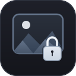

<div align="center">



# 🔒 PhotosCrypto
### Unified Final Release / Birlesik Nihai Surum

[](https://en.wikipedia.org/wiki/C%2B%2B17)
[](https://openssl.org)
[](https://www.tarsnap.com/scrypt.html)
[](https://zlib.net)
[](https://gtk.org)
[](https://flatpak.org)
[](LICENSE)

<br/>

</div>

> 🇬🇧 **[English] Important Update Note:** This repository is the unified and perfected final release of the previous PhotoBits project. All experimental branches, legacy code, and separate versions have been merged and completely overhauled into a single, seamless, and production-ready application.  
> 🇹🇷 **[Turkce] Onemli Guncelleme Notu:** Bu depo, onceki PhotoBits projesinin kusursuzluk ve sadelik icin bastan asagi elden gecirilmis, birlestirilmis nihai surumudur. Tum eski yapilar, ayrik surumler ve deneme kodlari tek bir cati altinda toplanmis ve mukemmel bir kararlilikla birlestirilmistir.

---

[English] PhotosCrypto is a modern C++17 application designed to hide, compress, and protect your private photos and confidential files. Instead of keeping files in recognizable image formats, it transforms your pictures into harmless-looking, encrypted text documents.

[Turkce] PhotosCrypto, ozel fotograflarinizi ve gizli dosyalarinizi gizlemek, sikistirmak ve korumak icin gelistirilmis modern bir C++17 uygulamasidir. Dosyalarinizi herkesin bildigi resim formatlarinda tutmak yerine, zararsiz gorunen sifrelenmis metin belgelerine donusturur.

---

## 🛠️ Unique Features & Distinctive Encryption System / Benzersiz Ozellikler ve Ozel Sifreleme Sistemi

[English]
1. Unconventional Custom Encryption and Steganographic Concealment:  
PhotosCrypto does not use conventional image containers. Your photo is never stored in an image format like PNG or JPG. Instead, it is transformed into a pure text document filled with a unique alphabet of mysterious symbols. To an outside observer, antivirus scanner, or file explorer, the file looks like a random, meaningless text note. This makes it extremely difficult for anyone to even suspect that a photo is hidden inside.

2. Impenetrable Security:  
Even if someone discovers or suspects that the text file contains an image, they still cannot open or recover it. The underlying data is locked using hardware-accelerated AES-256-GCM authenticated encryption and scrypt key derivation with high memory cost. Without the exact passphrase, the text remains mathematically impossible to decode. Any attempt to tamper with or modify the text immediately fails integrity checks.

3. Built-in Lossless Compression:  
Before encryption, image payloads are processed by a lossless zlib compression engine. This reduces file size by 40 percent to 80 percent, ensuring your encrypted text files take up minimal disk space.

4. Optional Password Freedom:  
Setting a password is completely up to the user. You can lock your files with a strong passphrase, or use the fast mode without a password to quickly disguise your photos into text notes for one-click restoration.

5. Intelligent Automatic Format Restoration:  
When you decode the text file, PhotosCrypto automatically detects the original file type such as PNG, JPG, WEBP, GIF, or BMP and restores your photo with its original quality and file extension.

6. Visual 5-Stage Security Shield:  
The graphical interface includes a dynamic security shield that evaluates your password in real time based on lowercase letters, uppercase letters, digits, and special characters, helping you create resilient passphrases.

7. Unified Dual Interface:  
Includes both an intuitive GTK4 desktop interface and a fast, standalone command-line tool for power users and automation scripts.

[Turkce]
1. Alisilmisin Disinda Kendine Has Sifreleme ve Kamuflaj Sistemi:  
PhotosCrypto siradan resim formatlarini veya bilindik dosya kaplarini kullanmaz. Fotograflariniz asla PNG veya JPG gibi bir gorsel formatinda saklanmaz. Bunun yerine, ozel bir sembol alfabesi kullanilarak tamamen siradan gorunumlu bir metin belgesine donusturulur. Dosya yoneticisinde, virus tarayicilarinda veya disaridan bakan birinin gozunde bu dosya yalnizca anlamsiz karakterlerden olusan siradan bir yazi notudur. Bu sayede dosyanin icinde bir fotograf saklandiginin fark edilmesi ve suphe cekmesi neredeyse imkansiz hale gelir.

2. Asilamaz Cift Katmanli Koruma:  
Bir kisi bu metin dosyasinin icinde bir fotograf oldugunu anlasa veya bundan suphelense bile, sifreleme mekanizmasi sayesinde dosyayi asla acamaz ve kurtaramaz. Veriler, yuksek bellek maliyetli scrypt anahtar algoritmasi ve AES-256-GCM kimlik dogrulamali sifreleme ile kilitlenir. Dogru sifre olmadan bu metni resme geri dondurmek matematiksel olarak imkansizdir. Metin uzerinde yapilacak en ufak bir degisiklik veya tahrifat ise guvenlik etiketi tarafindan aninda reddedilir.

3. Dahili Kayipsiz Veri Sikistirma:  
Fotograflar sifrelenmeden once dahili zlib motoru ile sikistirilir. Bu islem dosya boyutunu yuzde 40 ile yuzde 80 arasinda kuculterek metin dosyasinin diskte minimum yer kaplamasini saglar.

4. Istege Bagli Parola Secenegi:  
Sifre koymak tamamen kullanicinin tercihine birakilmistir. Ister cok guclu bir sifreyle tam guvenlik saglayabilir, isterseniz de tek tikla kolayca geri yuklemek icin sifresiz mod ile fotograflarinizi aninda metin dosyasina donusturebilirsiniz.

5. Akilli ve Otomatik Format Kurtarma:  
Metin dosyasini cozdugunuzde PhotosCrypto orijinal dosya turunu (PNG, JPG, WEBP, GIF, BMP vb.) otomatik olarak tanir ve fotografinizi sifir kalite kaybiyla dogru uzantisiyla geri cikarir.

6. 5 Kademeli Gorsel Guvenlik Kalkani:  
Grafik arayuz, sifrenizi yazarken buyuk harf, kucuk harf, rakam ve sembol cesitliligini analiz ederek guvenlik seviyenizi anlik olarak gosteren dinamik bir kalkan widget'ina sahiptir.

7. Birlestirilmis Cift Arayuz:  
Hem modern ve sade GTK4 masaustu grafik arayuzunu hem de gelismis kullanicilar ve scriptler icin bagimsiz komut satiri aracini tek bir catida sunar.

---

## ⚡ Performance & Architecture / Performans ve Mimari

[English]
-  Native Speed: Built in pure C++17 with optimized stream buffers, ensuring near-instantaneous encoding and decoding even for high-resolution images.
-  Minimal Memory Footprint: Memory is allocated in managed buffers and securely cleared immediately upon completion of the cryptographic operation.
-  Secure File Permissions: Output files are created with restricted file access permissions (0600 on Linux), ensuring other user accounts cannot inspect your files.

[Turkce]
-  Yerel Hiz: Saf C++17 ile yazilmis optimize akis tamponlari sayesinde yuksek cozunurluklu fotograflarda bile anlik donusturme performansi sunar.
-  Dusuk Bellek Kullanimi: Bellek tahsisleri kontrollu yapilir ve kriptografik islem biter bitmez guvenle sifirlanir.
-  Guvenli Dosya Izinleri: Olusturulan metin dosyalari yalnizca dosya sahibinin erisebilecegi kisitli izinlerle (Linux uzerinde 0600) uretilir.

---

## 📦 Installation Guide / Kurulum Rehberi

### 🐧 1. Linux Kurulumu / Linux Installation

####  Method A: Flatpak (Recommended / Onerilen)

[English] Install and run PhotosCrypto seamlessly in an isolated sandbox environment:  
[Turkce] PhotosCrypto uygulamasini guvenli bir sandbox ortaminda kolayca kurup calistirin:

```bash
git clone https://github.com/hunte-av/PhotosCrypto.git
cd PhotosCrypto
flatpak install flathub org.freedesktop.Sdk//25.08
flatpak-builder --user --install --force-clean build-dir io.github.hunte_av.PhotosCrypto.yml
flatpak run io.github.hunte_av.PhotosCrypto
```

####  Method B: Native Build from Source / Kaynak Koddan Derleme

[English] Install dependencies and compile natively:  
[Turkce] Bagimliliklari yukleyin ve yerel olarak derleyin:

- **Ubuntu / Debian:**
```bash
sudo apt update
sudo apt install build-essential pkg-config libssl-dev zlib1g-dev libgtk-4-dev libadwaita-1-dev
```

- **Fedora:**
```bash
sudo dnf install gcc-c++ make pkgconf openssl-devel zlib-devel gtk4-devel libadwaita-devel
```

- **Arch Linux:**
```bash
sudo pacman -S base-devel openssl zlib gtk4 libadwaita
```

- **Derleme ve Calistirma / Build and Run:**
```bash
make
make test
sudo make install
photoscrypto-cli --help
```

---

### 🪟 2. Windows Kurulumu / Windows Installation

[English] PhotosCrypto can be compiled on Windows using MSYS2 (UCRT64) to produce native Windows executables:  
[Turkce] PhotosCrypto, MSYS2 (UCRT64) kullanilarak dogrudan Windows uzerinde calisan yerel calistirilabilir dosyalar olarak derlenebilir:

1. [English] Download and install MSYS2 from msys2.org.  
   [Turkce] msys2.org adresinden MSYS2 uygulamasini indirip kurun.

2. [English] Open the MSYS2 UCRT64 terminal and install compiler tools and libraries:  
   [Turkce] MSYS2 UCRT64 terminalini acin ve derleme araclari ile kutuphaneleri yukleyin:
```bash
pacman -Syu
pacman -S mingw-w64-ucrt-x86_64-gcc mingw-w64-ucrt-x86_64-make mingw-w64-ucrt-x86_64-openssl mingw-w64-ucrt-x86_64-zlib mingw-w64-ucrt-x86_64-gtk4 mingw-w64-ucrt-x86_64-libadwaita git
```

3. [English] Clone the repository and compile:  
   [Turkce] Projeyi indirin ve derleyin:
```bash
git clone https://github.com/hunte-av/PhotosCrypto.git
cd PhotosCrypto
mingw32-make
```

4. [English] Run the executable:  
   [Turkce] Calistirilabilir dosyalari baslatin:
```bash
./photoscrypto-cli.exe --help
./photoscrypto-gui.exe
```

---

### 🍏 3. macOS Kurulumu / macOS Installation

[English] PhotosCrypto can be installed on macOS via Homebrew:  
[Turkce] PhotosCrypto macOS uzerinde Homebrew kullanilarak kolayca kurulabilir:

1. [English] Open Terminal and install dependencies:  
   [Turkce] Terminali acin ve bagimliliklari yukleyin:
```bash
brew install openssl zlib pkg-config make gcc gtk4 libadwaita
```

2. [English] Set Homebrew environment paths:  
   [Turkce] Homebrew kutuphane yollarini tanimlayin:
```bash
export PKG_CONFIG_PATH="$(brew --prefix openssl)/lib/pkgconfig:$(brew --prefix zlib)/lib/pkgconfig:$PKG_CONFIG_PATH"
```

3. [English] Clone and build:  
   [Turkce] Depoyu klonlayin ve derleyin:
```bash
git clone https://github.com/hunte-av/PhotosCrypto.git
cd PhotosCrypto
make
```

4. [English] Run PhotosCrypto:  
   [Turkce] PhotosCrypto uygulamasini baslatin:
```bash
./photoscrypto-cli --help
./photoscrypto-gui
```

---

##  Command Line Usage / Komut Satiri Kullanimi

### 1.  Encode with Password / Parolali Sifreleme
[English] Encrypts the photo and turns it into a disguised text file:  
[Turkce] Fotografi sifreler ve siradan bir metin belgesine donusturur:
```bash
photoscrypto-cli encode my_photo.png secret_notes.txt
```

### 2.  Decode with Password / Parolali Cozme
[English] Restores the disguised text file back into the original photo:  
[Turkce] Metin belgesini sifrenizi girerek orijinal fotograf haline geri cevirir:
```bash
photoscrypto-cli decode secret_notes.txt restored_photo
```

### 3.  Encode without Password (Fast Mode) / Sifresiz Hizli Gizleme
[English] Disguises the photo into text without requiring a password:  
[Turkce] Sifre sormadan fotografi hizlica metin dosyasina donusturur:
```bash
photoscrypto-cli encode my_photo.png secret_notes.txt --no-password
```

### 4.  Decode without Password / Sifresiz Geri Yukleme
[English] Instantly restores the photo with a single command:  
[Turkce] Tek komutla fotografi aninda geri yukler:
```bash
photoscrypto-cli decode secret_notes.txt restored_photo
```

---

## ⚠️ Critical Security Reminders / Kritik Guvenlik Hatirlatmalari

[English]
- 🛡️ If you set a password and forget it, the photo cannot be recovered. There are no backdoors or master keys.
- 📄 Because the output is a standard text file, you can safely store it anywhere without drawing attention.
- 🔒 Even if an intruder inspects the text file and realizes it holds data, the AES-256-GCM encryption prevents unauthorized extraction.

[Turkce]
- 🛡️ Sifre belirleyip unutursaniz, fotografi geri getirmek mumkun degildir. Hicbir arka kapi veya kurtarma anahtari bulunmaz.
- 📄 Cikti siradan bir metin dosyasi oldugu icin, dikkat cekmeden her yerde guvenle saklanabilir.
- 🔒 Bir saldirgan metin belgesini inceleyip icinde bir veri oldugunu anlasa bile, AES-256-GCM sifrelemesi sayesinde dogru parola olmadan dosyayi asla acamaz.

---

## 📜 License / Lisans

[English] Distributed under the MIT License. See LICENSE for details.  
[Turkce] MIT Lisansi ile dagitilmaktadir. Ayrintilar icin LICENSE dosyasina bakiniz.
